  

  

  <picture>
    <source media="(prefers-color-scheme: dark)" srcset="https://raw.githubusercontent.com/LATRECHE-A/LATRECHE-A/output/snake-dark.svg" />
    <source media="(prefers-color-scheme: light)" srcset="https://raw.githubusercontent.com/LATRECHE-A/LATRECHE-A/output/snake.svg" />
    
  </picture>

the penguin and the bear are raymarched in python (<a href="scripts/render.py">render.py</a>), stats and snake refresh every day

